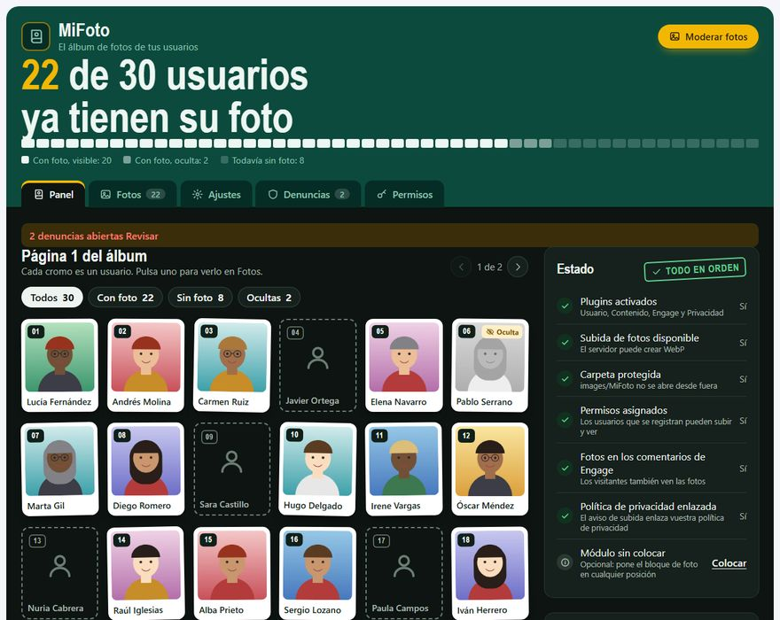
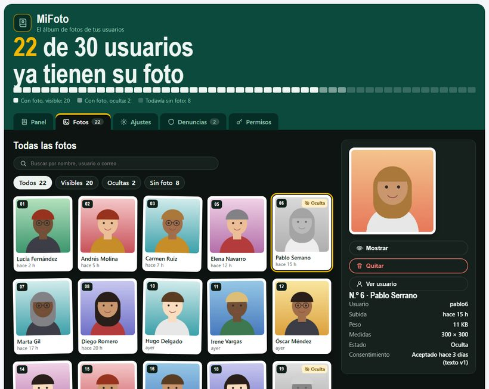
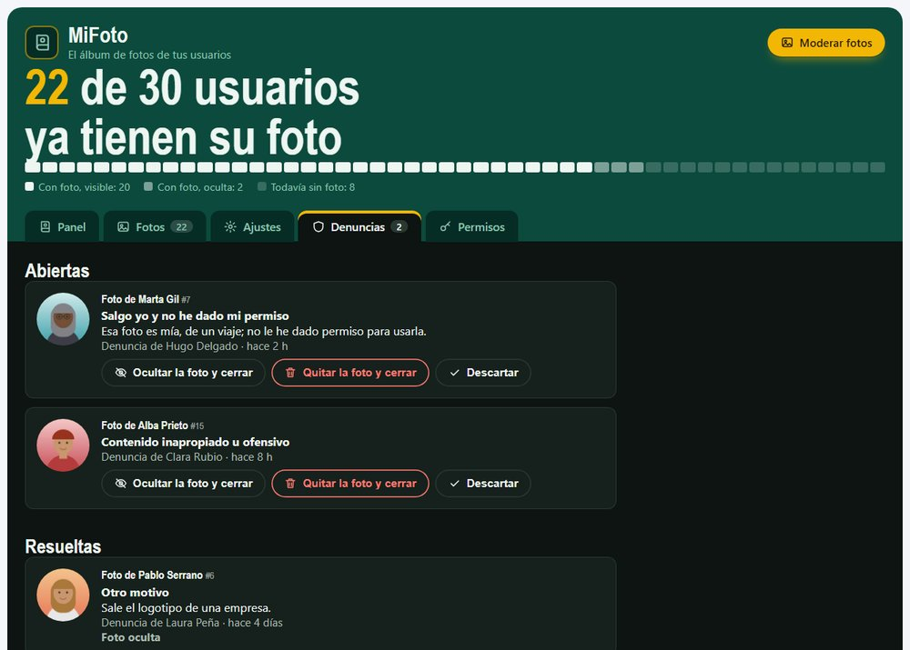
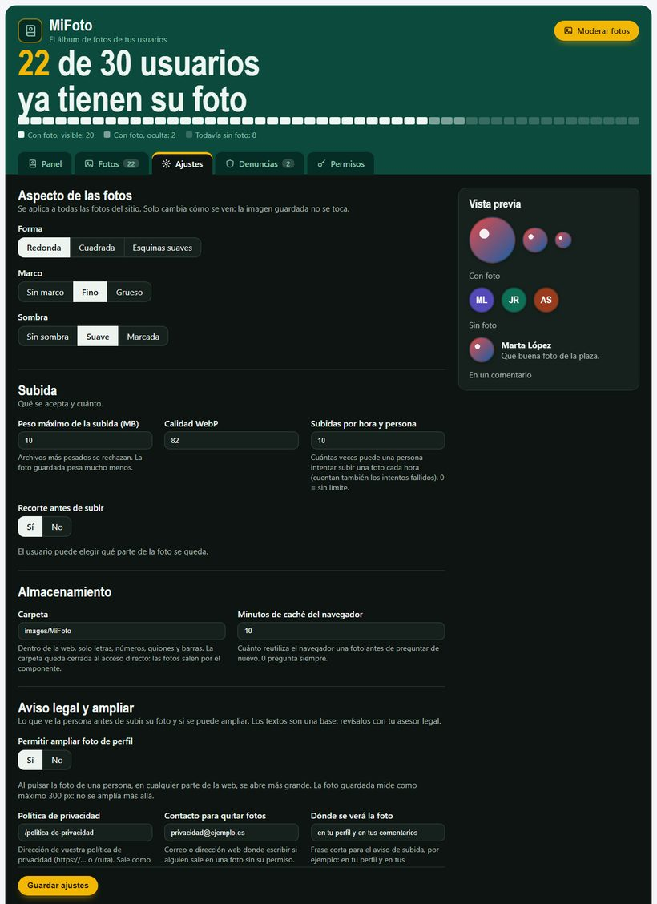
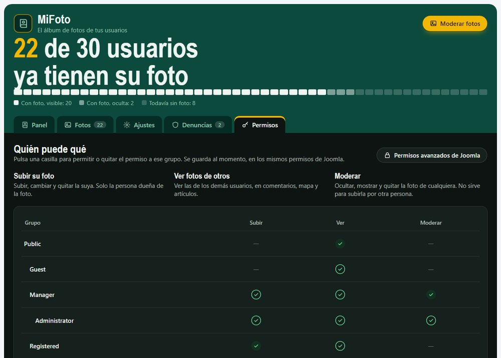
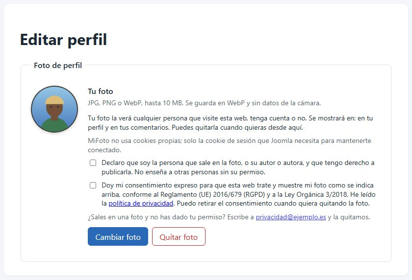
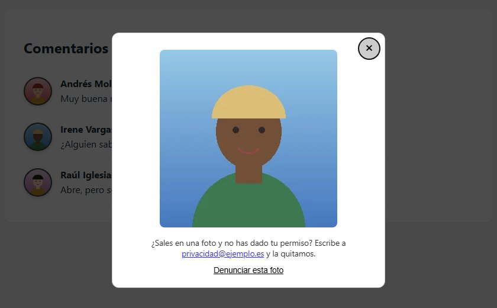

<h1 align="center">MiFoto</h1>

<p align="center">
  Fotos de perfil para Joomla: cada persona sube la suya desde su perfil y tú decides quién la ve y cómo se ve.<br>
  Subida segura, aviso legal con consentimiento, denuncias y moderación. Otras extensiones (comentarios, módulos, artículos) la usan.
</p>

<p align="center">
  <a href="../../releases/latest"></a>
  
  
  
</p>

<p align="center">
  
</p>

<p align="center">
  <a href="#qué-hace">Qué hace</a> ·
  <a href="#todas-las-opciones">Todas las opciones</a> ·
  <a href="#instalar">Instalar</a> ·
  <a href="#seguridad">Seguridad</a> ·
  <a href="#autor-y-licencia">Licencia</a>
</p>

> Las capturas están hechas con datos inventados: los nombres y las «fotos» son ilustraciones de prueba.

## Qué hace

| | |
|---|---|
| **Subida segura** | La foto se mira por dentro (no por el nombre), se vuelve a dibujar entera y se guarda en WebP de 300 px. No queda nada del original: ni GPS ni datos de la cámara. |
| **Fotos privadas** | Se guardan en una carpeta cerrada y solo salen por MiFoto, que comprueba en cada petición si quien mira tiene permiso. |
| **Permisos con un clic** | Subir, Ver y Moderar, por grupo de usuarios, en una tabla: pulsas la casilla y queda guardado. |
| **Tú decides el aspecto** | Forma, marco y sombra iguales en toda la web. Quien no tiene foto sale con sus iniciales sobre un color fijo. |
| **Aviso legal y consentimiento** | Antes de subir, la persona ve quién verá su foto y dónde, y marca dos casillas. La aceptación queda registrada (sin IP). |
| **Denuncias y moderación** | Cualquier persona con sesión puede denunciar una foto al ampliarla; tú ocultas, quitas o descartas desde una pestaña. |
| **Funciona con otras extensiones** | Comentarios de Akeeba Engage, la etiqueta `{user}` en artículos, un módulo y un servicio PHP para quien programe. |

**Probado en:** Joomla 6.2 · PHP 8.4 · plantilla Helix Ultimate · Akeeba Engage 3.4.14 (hasta la versión 0.4).
Lo nuevo de la 0.5 (consentimiento, denuncias, ampliar foto y plugin de privacidad) pasa sus 353 pruebas automáticas
pero **todavía no se ha probado en un Joomla real**.

## Todas las opciones

MiFoto se abre en **Componentes › MiFoto**. Arriba siempre ves cuántos usuarios tienen foto y las pestañas.
Algunas pestañas solo salen a quien tiene permiso: Denuncias a quien modera y Ajustes a quien administra.

### Panel

El álbum: cada usuario es un cromo numerado con su foto, o un hueco si todavía no la ha subido. Es la captura de arriba.

| Parte | Qué hace | Valores |
|---|---|---|
| Álbum | 24 cromos por página. Al pulsar uno se abre en Fotos. | Filtros: Todos, Con foto, Sin foto, Ocultas |
| Recién pegados | Las 6 últimas fotos subidas, para echarles un ojo. | — |
| Estado | Comprueba la instalación y dice qué falta, con un botón para arreglarlo: plugins activados, que el servidor pueda crear WebP, carpeta protegida (avisa si el servidor es nginx), permisos dados, fotos visibles en Engage, política de privacidad enlazada y módulo colocado. | «Todo en orden» o número de avisos |
| Quién puede qué | Resumen de la tabla de permisos. | Enlace a Permisos |
| Aviso de denuncias | Si hay denuncias sin revisar, sale arriba con el enlace. | — |

Quien entra sin permiso de moderar ve solo las cifras, no los nombres.

### Fotos

| Parte | Qué hace | Valores |
|---|---|---|
| Buscador | Busca por nombre, usuario o correo. | Texto |
| Filtros | Qué fotos se ven. | Todas, Visibles, Ocultas, Sin foto |
| Foto seleccionada | La foto en grande con sus datos: usuario, cuándo se subió, peso, medidas, estado y consentimiento. | — |
| Ocultar / Mostrar | Una foto oculta solo la ven su dueño y los moderadores. | — |
| Quitar | Borra la foto (pide confirmación). La persona puede subir otra. | — |
| Ver usuario | Abre la ficha del usuario en Joomla. | — |

Un moderador no puede subir una foto por otra persona: solo su dueño.

<details><summary>Ver la pantalla Fotos</summary></details>

### Denuncias

| Parte | Qué hace | Valores |
|---|---|---|
| Abiertas | Cada denuncia: de quién es la foto, el motivo, el comentario, quién denuncia y cuándo. | — |
| Ocultar la foto y cerrar | Oculta la foto y cierra todas sus denuncias abiertas. | — |
| Quitar la foto y cerrar | Borra la foto (pide confirmación) y cierra sus denuncias. | — |
| Descartar | Cierra la denuncia sin tocar la foto. | — |
| Resueltas | Las ya revisadas, con lo que se hizo. | Foto oculta, Foto quitada, Descartada |

Motivos que puede elegir quien denuncia: «Salgo yo y no he dado mi permiso», «La persona no ha dado su permiso»,
«Contenido inapropiado u ofensivo», «Sale un menor de edad» y «Otro motivo». No se envían correos: las denuncias se ven aquí y en el Panel.

<details><summary>Ver la pantalla Denuncias</summary></details>

### Ajustes

A la derecha, una vista previa enseña cómo quedan las fotos mientras cambias el aspecto.

| Opción | Qué hace | Valores |
|---|---|---|
| Forma | Forma de todas las fotos del sitio. Solo cambia cómo se ven, no la imagen. | Redonda (por defecto), Cuadrada, Esquinas suaves |
| Marco | Borde alrededor de la foto. | Sin marco (por defecto), Fino, Grueso |
| Sombra | Sombra debajo de la foto. | Sin sombra (por defecto), Suave, Marcada |
| Peso máximo de la subida (MB) | Los archivos más pesados se rechazan. La foto guardada pesa mucho menos. | 1-20 (por defecto 10) |
| Calidad WebP | Calidad de la foto guardada. | 50-95 (por defecto 82) |
| Subidas por hora y persona | Intentos de subida por hora; cuentan también los fallidos. | 0-1000 (por defecto 10; 0 = sin límite) |
| Recorte antes de subir | La persona elige qué parte de la foto se queda (arrastrar y zoom). | Sí (por defecto) / No |
| Carpeta | Dónde se guardan las fotos. Tiene que estar dentro de `images/`; queda cerrada al acceso directo. | Por defecto `images/MiFoto` |
| Minutos de caché del navegador | Cuánto reutiliza el navegador una foto antes de volver a preguntar. | 0-1440 (por defecto 10) |
| Permitir ampliar foto de perfil | Al pulsar una foto de MiFoto, en cualquier parte de la web, se abre más grande (hasta 300 px). | Sí (por defecto) / No |
| Política de privacidad | Enlace junto a las casillas del consentimiento. | Dirección `https://…` o `/ruta`; vacía = sin enlace |
| Contacto para quitar fotos | Correo o web donde pedir que se quite una foto. Sale en el aviso y al ampliar la foto. | Correo o `https://…` |
| Dónde se verá la foto | Frase corta para el aviso de subida, por ejemplo «en tu perfil y en tus comentarios». | Texto (hasta 200 letras); vacía = frase general |

El lado mayor de la foto guardada es siempre 300 px. Los textos legales son una base: revísalos con tu asesor.

<details><summary>Ver la pantalla Ajustes</summary></details>

### Permisos

| Permiso | Qué hace | Normalmente a |
|---|---|---|
| Subir su foto | Subir, cambiar y quitar la suya. | Registered |
| Ver fotos de otros | Ver las fotos de los demás en comentarios, artículos, módulos… | Registered, o Public si quieres que las vea cualquier visitante |
| Moderar | Ocultar, mostrar y quitar la foto de cualquiera. | Manager, Administrator |

Se pulsa la casilla del grupo y se guarda al momento, con opción de deshacer. Las marcas dicen si el permiso es del grupo,
si lo hereda de un grupo de arriba, si no lo tiene, si es fijo (Super Users) o si está denegado a propósito
(eso se cambia en «Permisos avanzados de Joomla»). Los permisos empiezan sin dar: hasta que no los des, nadie sube ni ve fotos.
Cambiar permisos necesita ser administrador del componente.

> **Para que los visitantes sin sesión vean las fotos hacen falta tres cosas:** el permiso «Ver» para **Public**,
> la foto **visible** y el plugin que la pinta («Engage - MiFoto» o «Contenido - MiFoto») con **Acceso = Public**.
> El instalador deja los plugins en Public y el Panel avisa si no lo están.

<details><summary>Ver la pantalla Permisos</summary></details>

### El bloque «Foto de perfil» (lo que ve cada usuario)

Sale en la página de su perfil (plugin «Usuario - MiFoto») o donde coloques el módulo.

| Parte | Qué hace |
|---|---|
| Tu foto | La foto actual, o las iniciales si no tiene. |
| Aviso | Quién verá la foto (se calcula con los permisos reales: cualquier visitante, solo con sesión o solo quien tú permitas) y dónde. Dice también que MiFoto no usa cookies propias. |
| Dos casillas | «Soy la persona de la foto o su autor» y el consentimiento para tratar y mostrar la foto (RGPD y LOPDGDD), con el enlace a tu política de privacidad. Sin las dos no se puede subir. |
| Subir / Cambiar foto | JPG, PNG o WebP. Si el recorte está activado, se encuadra antes de subir. |
| Quitar foto | Borra la foto y marca el consentimiento como retirado. |

<details><summary>Ver el bloque del perfil</summary></details>

### Ampliar foto y denunciar (en la web)

Con «Permitir ampliar foto de perfil» activado, cualquier foto de MiFoto se abre en grande al pulsarla, venga de la extensión que venga.
Debajo salen el contacto para quitar fotos y, a quien tiene sesión, el enlace **Denunciar esta foto** (motivo y comentario opcional).
No se puede denunciar la propia, ni la misma dos veces mientras siga abierta, y hay un máximo de 10 denuncias al día por persona.

<details><summary>Ver la foto ampliada</summary></details>

### Plugins y módulo

| Pieza | Qué hace | Opciones |
|---|---|---|
| **Usuario - MiFoto** | Pone el bloque «Foto de perfil» en el perfil y la moderación (ocultar, mostrar, quitar) en la ficha de cada usuario del administrador. | — |
| **Contenido - MiFoto** | Cambia las etiquetas `{user}` por fotos en artículos y módulos: `{user}` la de quien lee, `{user 42}` la del usuario 42, `{user 42 size=96}` a 96 px. | Tamaño por defecto: 32, 64 (por defecto), 96, 128 o 300 px |
| **Engage - MiFoto** | Usa la foto como avatar en los comentarios de Akeeba Engage. Ponlo antes que «Engage - Gravatar» en el orden de plugins. | — |
| **Privacidad - MiFoto** | Añade la foto, los consentimientos y las denuncias de una persona a las peticiones de privacidad de Joomla (exportar y borrar sus datos). | — |
| **MiFoto - Foto del usuario** (módulo) | El mismo bloque del perfil donde lo coloques, por si tu plantilla no lo muestra. A quien no tiene sesión no le enseña nada. | — |

Guía completa, con soluciones a problemas: [docs/GUIA.md](docs/GUIA.md) · en inglés: [docs/GUIDE.md](docs/GUIDE.md).

## Instalar

1. Descarga el ZIP de la [última versión](../../releases/latest) (`pkg_mifoto_<versión>.zip`).
2. En Joomla: **Extensiones › Gestionar › Instalar** y sube el ZIP tal cual, sin descomprimir.
3. Los plugins se activan solos la primera vez. Compruébalo en **Extensiones › Plugins** (busca «MiFoto»).
4. Ve a **Componentes › MiFoto › Permisos** y da a **Registered** los permisos «Subir» y «Ver». Si quieres que los visitantes vean las fotos, da «Ver» también a **Public**.
5. En **Ajustes** pon la dirección de tu política de privacidad y, si quieres, un contacto para quitar fotos.
6. Si el bloque no sale en el perfil (pasa con algunas plantillas), coloca el módulo **MiFoto - Foto del usuario** en esa página.

Necesita PHP 8.1 o superior con la extensión **GD con soporte WebP** (el Panel avisa si falta).

<details><summary>Actualizar, desinstalar y programar</summary>

**Actualizar:** instala el ZIP nuevo encima, **sin desinstalar**. Joomla conserva opciones, permisos, fotos y qué plugins tienes activados.

**Desinstalar:** no borra las fotos ni sus tablas; si lo vuelves a instalar, todo sigue ahí. Sí se pierden las opciones y los permisos.
Para borrarlo todo: elimina a mano las tablas `#__mifoto_photos`, `#__mifoto_limits`, `#__mifoto_consents` y `#__mifoto_reports` y la carpeta `images/MiFoto`.

**Para programar otra extensión** que use las fotos:

```php
$service = \Joomla\CMS\Factory::getApplication()->bootComponent('com_mifoto')->getPhotoService();
$photo   = $service->getPhoto($userId, 64);                  // null si no tiene o quien mira no puede verla
$html    = $service->avatarHtml($userId, 64, null, 'Marta'); //  o iniciales, ya escapado
```

**Generar el ZIP y pasar las pruebas** (desde el código):

```
python build/build.py      # crea dist/pkg_mifoto_<versión>.zip
php tests/01-imagen.php    # y 02, 04, 05, 06, 07, 08; node tests/03-recorte.js y tests/08-lightbox.js
```
</details>

## Seguridad

<details><summary>Qué hace el código para proteger la web y las fotos</summary>

- **Subidas:** el tipo se saca de los bytes del archivo, no del nombre ni de lo que diga el navegador. Solo JPG, PNG y WebP.
  Se rechazan las «bombas» (imágenes pequeñas en bytes pero enormes en píxeles) y los archivos con código escondido
  (`<?php`, `<script`, `<svg`…). La foto se decodifica y se vuelve a codificar en WebP: no sobreviven metadatos (EXIF, GPS, XMP) ni nada incrustado.
- **Carpeta cerrada:** las fotos se guardan con nombre aleatorio en una carpeta con `.htaccess` y `web.config` que prohíben el acceso directo
  (en nginx hay que bloquearla en el servidor; el Panel lo avisa). Salen por el componente, que comprueba el permiso en cada petición.
- **Sin números de usuario a la vista:** la dirección de una foto usa una clave aleatoria; el número de usuario no sale del servidor.
  `{user 42}` no enseña nada si no hay foto visible, para no delatar qué usuarios existen.
- **Permisos de Joomla (ACL):** `mifoto.upload`, `mifoto.view` y `mifoto.moderate`, comprobados en el servidor en cada acción.
  Cambiar permisos exige `core.admin`; los ajustes, `core.admin` o `core.options`.
- **CSRF:** todas las acciones que cambian algo (subir, quitar, moderar, denunciar, permisos) van por POST con el token de Joomla.
- **Base de datos:** consultas preparadas con parámetros, sin texto del usuario pegado en el SQL.
- **Escapado:** todo lo que se pinta se escapa; la foto ampliada mete los textos con `textContent`. Las opciones se limpian al leerlas
  (la carpeta solo puede ser una subcarpeta de `images/`, la política solo `http(s)` o una ruta del sitio, forma, marco y sombra solo de una lista).
- **Cabeceras:** las respuestas llevan `X-Content-Type-Options: nosniff`; las fotos, además, `Content-Security-Policy` y caché `private`.
- **Límites:** subidas por hora y persona (configurable) y 10 denuncias al día por persona.
- **Privacidad (RGPD):** consentimiento expreso obligatorio antes de subir; se guarda quién, cuándo, qué versión del texto y para qué foto,
  **sin IP ni navegador**. Quitar la foto marca el consentimiento como retirado. El plugin de privacidad exporta y borra los datos de una persona,
  y al borrar una cuenta se borra su foto. MiFoto no usa cookies propias. Los textos legales son una base, no asesoramiento jurídico.
</details>

## Autor y licencia

Desarrollado por **ChasKa**. Licencia [GPL-3.0 o posterior](LICENSE).

<details><summary>Componentes de terceros</summary>

MiFoto no incluye librerías ni fuentes de terceros: todo el código es propio y usa lo que ya trae Joomla.

| Nombre | Para qué | Licencia |
|---|---|---|
| [Joomla!](https://www.joomla.org/) | La plataforma sobre la que funciona (no va incluido en el paquete) | GPL-2.0 o posterior |
| [Akeeba Engage](https://www.akeeba.com/products/engage.html) | Opcional: el plugin «Engage - MiFoto» pone las fotos en sus comentarios (no va incluido) | GPL-3.0 |

Joomla! es marca de Open Source Matters; este proyecto no está afiliado a Open Source Matters ni al proyecto Joomla.
</details>
